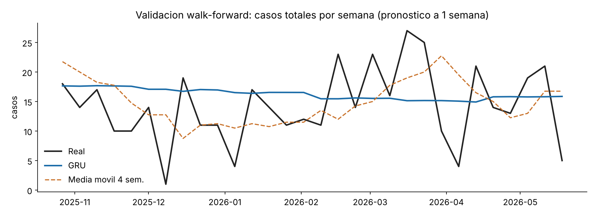

# Pronóstico de violencias basadas en género contra mujeres indígenas del Cauca (GRU/LSTM)

Taller ABP – Entrega 1 · Curso **Deep Learning** · Fundación Universitaria Católica del Norte (ver `docs/presentacion.pdf`)

Modelo recurrente en **PyTorch** que pronostica, con una semana de anticipación, el número de casos de VBG registrados por zona del
Consejo Regional Indígena del Cauca (CRIC).

## 1. Problema y datos
* **Fuente:** Observatorio de VBG – Programa Mujeres CRIC, con datos de vigilancia de la AIC-EPSI (hoja `OBSERVATORIO 2025 2026 AIC`), enero 2025 – junio 2026.
* **Alcance:** mujeres indígenas atendidas/registradas por el Observatorio. **No** representa a todo el departamento del Cauca.
* **Casos usados:** 1.217 (de 1.239; se descartaron 22 con fecha posterior al corte del boletín, 30-jun-2026).
* **Datos de este repositorio:** únicamente conteos agregados `semana × zona` en `data/processed/`. El archivo original contiene nombres, cédulas y teléfonos de víctimas y **no se publica** (`.gitignore`).
* **Calidad:** las semanas posteriores al 18-may-2026 están incompletas (rezago de registro) y se excluyeron. Resultado: 73 semanas, 6 series (5 zonas principales + `OTRAS`).

## 2. Arquitectura
```
8 semanas × 6 zonas → log1p → GRU(16) → Dropout(0.2) → Linear(6) → softplus → λ Poisson por zona (semana siguiente)
```
1.254 parámetros · pérdida *Poisson NLL* · AdamW (lr 5e-3, wd 1e-3) · *early stopping* · *ensemble* de 5 semillas. También se evalúa una variante LSTM.

## 3. Evaluación
Validación **walk-forward** (ventana expansiva, reentrenamiento cada 5 semanas): 30 semanas de prueba, pronóstico a 1 semana.

| Modelo | MAE (zona-semana) | RMSE | Devianza Poisson | MAE total semanal |
|---|---|---|---|---|
| **GRU** | **1.545** | **2.063** | **1.801** | 5.615 |
| LSTM | 1.544 | 2.070 | 1.803 | 5.632 |
| Media histórica | 1.578 | 2.134 | 1.844 | 5.863 |
| Media móvil 4 sem. | 1.600 | 2.207 | 2.075 | **5.217** |
| Media móvil 8 sem. | 1.619 | 2.181 | 1.970 | 5.808 |
| Última semana | 2.050 | 2.975 | 13.846 | 6.967 |



### Lectura honesta de los resultados
* El GRU/LSTM supera por muy poco a los baselines por zona, **pero no de forma concluyente**: en el total semanal la media móvil de 4 semanas es mejor, y el IC95 bootstrap de la diferencia en MAE total (GRU − MM4) es [−1.04, +1.70], que incluye el cero.
* El modelo aprende sobre todo el **nivel medio** de cada zona; con ~1.200 casos en 73 semanas, la variación semanal es en gran parte ruido de conteo. Más datos (más años, fuentes adicionales) son la mejora más probable.

## 4. Limitaciones y uso responsable
* Son casos **registrados**: hay subregistro (miedo a denunciar, cobertura desigual de IPS/ESE, zonas con conflicto armado).
* Los casos reflejan además dónde existe mayor capacidad de registro y mayor población (p. ej. Nasa), no necesariamente mayor incidencia.
* Uso previsto: apoyo a la planeación de recursos y rutas de atención. **No** usar para vigilar o señalar personas o comunidades. La publicación de datos debe respetar la gobernanza de datos del CRIC.

## 5. Cómo ejecutar
```bash
pip install -r requirements.txt
jupyter nbconvert --to notebook --execute --inplace notebooks/01_modelo_vbg_cauca.ipynb   # reproduce todo
# o paso a paso:
python src/prepare_data.py ruta/OBSERVATORIO_2026.xlsx   # solo si cuentas con el Excel original (autorizado)
PYTHONPATH=src python src/evaluate.py                    # métricas walk-forward
PYTHONPATH=src python src/make_figures.py                # figuras
PYTHONPATH=src python src/train_final.py                 # modelo final en models/
```
Semillas fijas; los resultados pueden variar ligeramente entre versiones de PyTorch/hardware.

## 6. Estructura
```
data/processed/   conteos agregados (sin datos personales)
src/              prepare_data, model, evaluate, make_figures, train_final
notebooks/        01_modelo_vbg_cauca.ipynb (ejecutado)
models/           gru_vbg_cric.pt
reports/          métricas (csv/json) y figuras
docs/             presentacion.pdf / .pptx
```
**Autoría:** _(agregar nombres)_ · **Licencia del código:** _(elegir, p. ej. MIT)_ · Datos: propiedad del Proceso de Mujeres CRIC.
